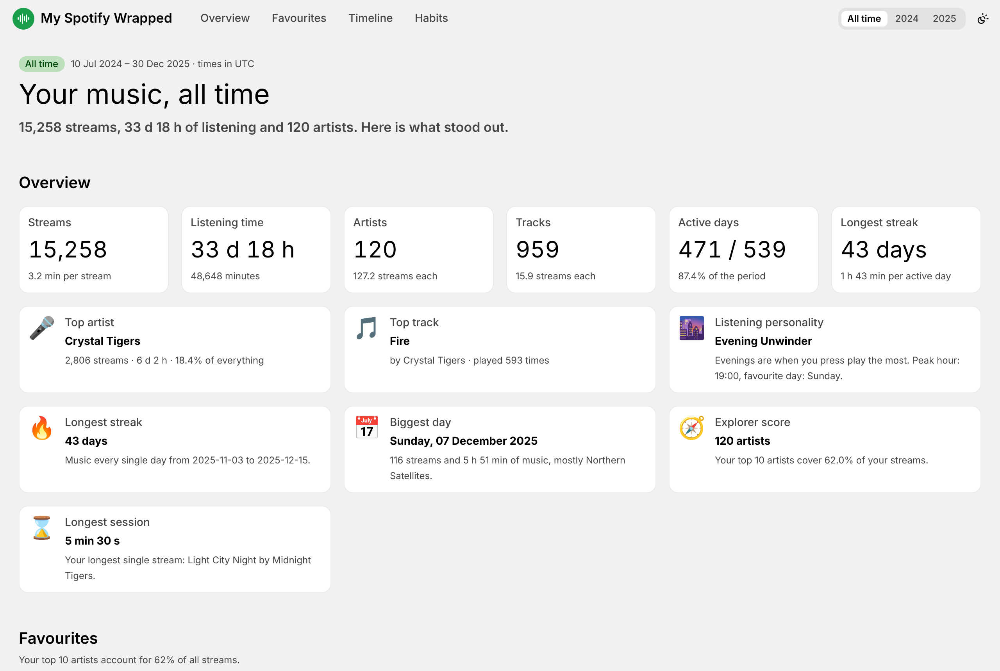
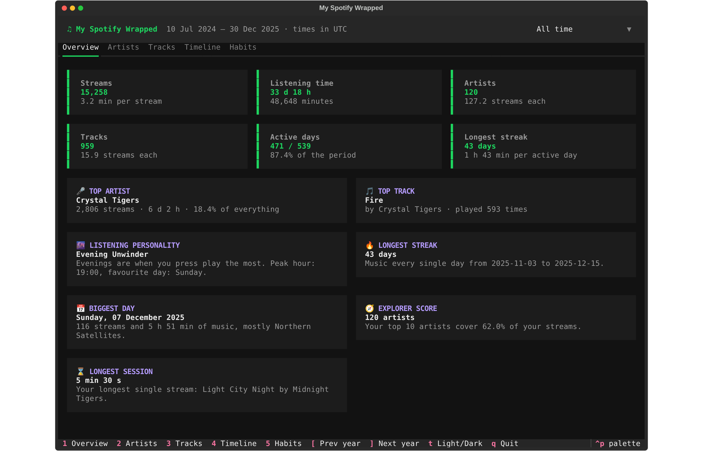
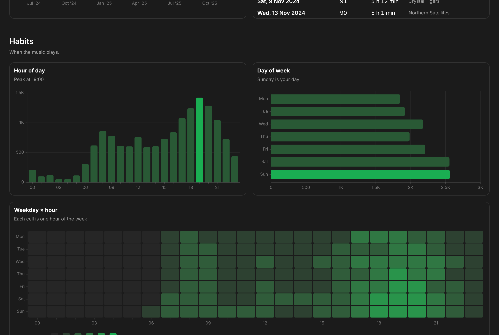
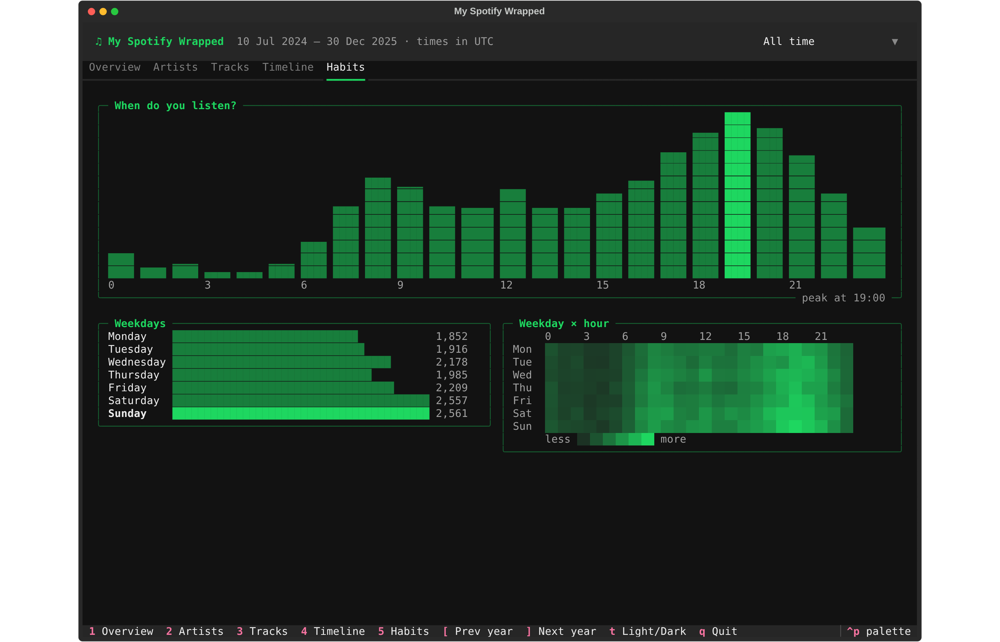

# My Spotify Wrapped

I created this project because a good friend of mine was not satisfied with the content of 2022's Spotify Wrapped.
It turns the data Spotify gathers about you into your own Wrapped: **in the terminal** or as **a web page** you can open in any browser.

It uses the personal data export you can request from Spotify on your [privacy page](https://www.spotify.com/account/privacy/) at any time (thanks to the European GDPR).
Everything is computed locally on your computer. Nothing is uploaded anywhere.

| Web report | Terminal UI |
| --- | --- |
|  |  |
|  |  |

## What you get

- Totals: streams, listening time, artists, tracks, active days and your longest daily streak
- Highlights: top artist and track, biggest day, your "listening personality" and more
- Rankings: top artists, tracks and albums by streams or by listening time, plus the least streamed artists
- Timeline: streams per week and month and your biggest days
- Habits: hour of day, day of week and a weekday × hour heatmap
- Taste (with `--genres`): a genre pie chart, your *atzig / fotzig / mausig* holy trinity as a radar chart, a mood (happy ↔ sad) heatmap by weekday and hour, and which genres you play at which hour
- A view for all time and for every single year

## Usage

1. [Install uv](https://docs.astral.sh/uv/getting-started/installation/) and clone this repository.
2. Request your data from Spotify. Either the "Account data" or the "Extended streaming history" works; both are supported.
3. Unpack the archive you got from Spotify.
4. Run one of the commands below. `--data` takes the unpacked folder (or a single JSON file).

```bash
uv run spotify-wrapped tui --data ~/Downloads/my_spotify_data
```

```bash
uv run spotify-wrapped web --data ~/Downloads/my_spotify_data --open
```

Want to look around first? Replace `--data …` with `--demo` to use a generated, fictional history.

| Command | What it does |
| --- | --- |
| `spotify-wrapped tui` | Interactive terminal UI. Keys: `1`–`6` switch tabs, `[` / `]` switch the year, `t` toggles light/dark, `q` quits. |
| `spotify-wrapped tui --serve` | The same terminal UI, served in your browser (via textual-serve) on port 8000. |
| `spotify-wrapped web` | Writes `spotify_wrapped.html`: one self-contained file that works offline and can be shared. `-o` sets the file or folder. |
| `spotify-wrapped json` | Prints (or with `-o` writes) the raw statistics as JSON. |

Options for all commands: `--year 2024` opens a specific year, `--top 20` changes the length of the rankings, and `--timezone Europe/Berlin` sets the timezone used for hours and days (by default, the timezone of your computer).

### Genres, mood and the holy trinity

Spotify's export contains no genres, so the Taste statistics need them from somewhere else:

```bash
uv run spotify-wrapped web --data ~/Downloads/my_spotify_data --genres --open
```

`--genres` looks up the genres of your 250 most played artists (change with `--genre-artists N`) on [MusicBrainz](https://musicbrainz.org). Only artist names are sent. MusicBrainz allows one request per second, so the first run takes a few minutes; results are cached in `~/.cache/spotify-wrapped/`, so later runs are instant. You can also provide the genres yourself: `--genres my_genres.json` with `{"Artist": "Hip-Hop & Rap", "Other artist": ["dream pop", "sad"]}` (a genre name or a list of tags).

The tags are folded into 13 genres (see `src/spotify_wrapped/genres.py`). Each genre has a typical *happiness* (valence) and a profile for the trinity of [atzigfotzigmausig.de](https://atzigfotzigmausig.de/):

- **atzig**: rowdy party energy (Techno, Schlager, Metal …), plus a bonus for listening on Friday and Saturday nights
- **fotzig**: sassy, self-confident attitude (Rap, R&B, Reggaeton, diva pop …), plus a bonus for impatiently skipping songs
- **mausig**: soft, cosy and dreamy (Indie, singer-songwriter, classical …), plus a bonus for Sundays and early mornings

These are estimates per artist genre, not per song.

The old interface `python main.py -d DATA -s OUT_FOLDER` still works and creates the web report.

## How it is built

```
src/spotify_wrapped/
├── loader.py        reads both Spotify export formats into one table
├── enrich.py        optional genre lookup per artist (MusicBrainz or a JSON file)
├── genres.py        genre taxonomy with mood and atzig/fotzig/mausig profiles
├── statistics.py    ALL processing: builds a Report (plain dataclasses, JSON serializable)
├── tui/             Textual app that renders a Report
├── web.py           puts a Report (as JSON) into the prebuilt web page
├── web_template/    the built web UI (generated by `npm run build`)
└── cli.py           the `spotify-wrapped` command
web/                 React web UI: Meta Astryx components + TanStack Charts
```

Both user interfaces only display what `statistics.py` computed, so they always show the same numbers. `web/src/types.ts` mirrors the Python dataclasses.

### Development

```bash
uv sync
```

```bash
uv run pytest
```

```bash
uv run mypy
```

The web UI needs Node.js 22+ only if you want to change it. The built page is committed, so the commands above work without Node.

```bash
cd web && npm install && npm run demo-data && npm run dev
```

`npm run build` type-checks the app and writes the single-file page to `src/spotify_wrapped/web_template/index.html`.

## Upcoming
- [ ] Executable for every major operating system
